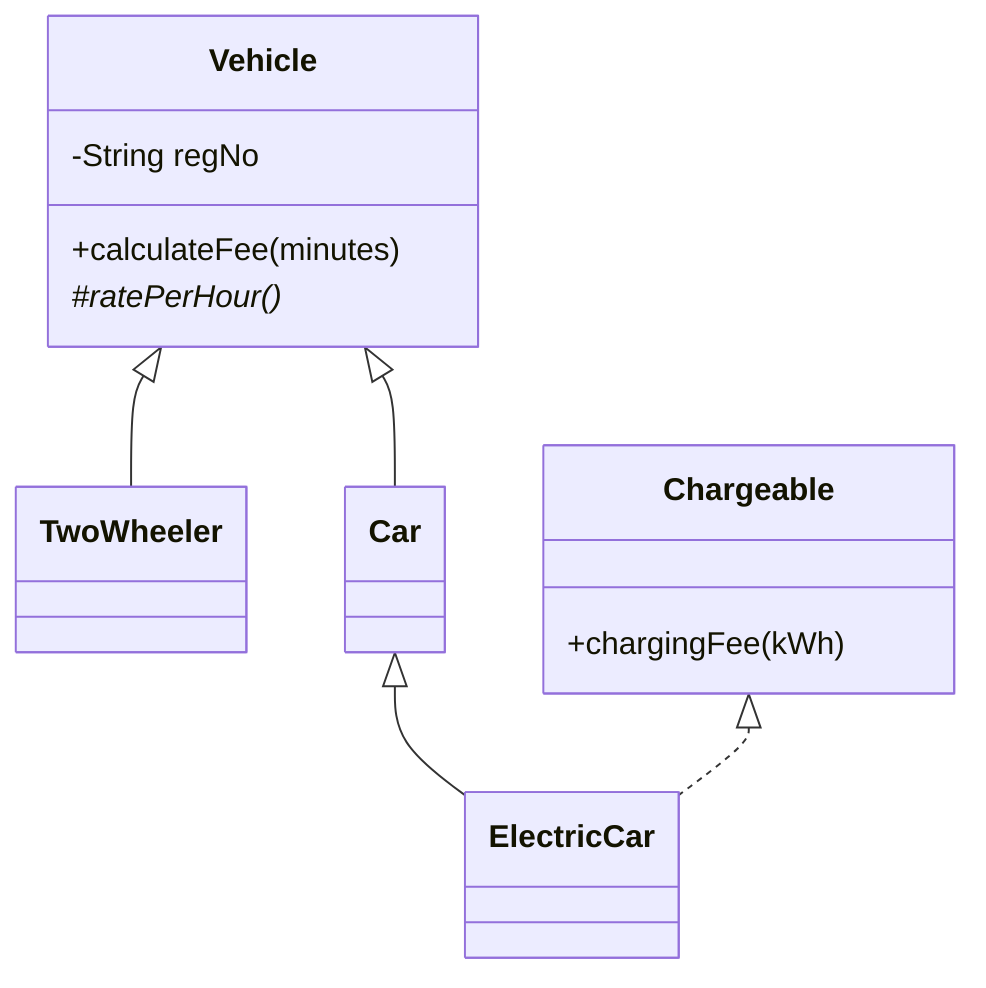

# Assignment 1 — Campus Smart-Parking System

**Student:** Md Aslam  
**Register number:** `[Enter your register number before submission]`  
**Repository:** https://github.com/Md-Aslam-31/CSA0903-JAVA  
**Language/runtime:** Java 17

> This report answers the assignment sheet's Tasks 1–12. Requirements quoted by the sheet (individual execution, per-task folders, README and output evidence) are treated as course instructions. The repository destination and task are taken from the student's request. Rates, pass policy and time-boundary interpretation below are explicit implementation assumptions where the sheet does not define exact values.

## Task 1 — Problem analysis and candidate objects

### Inputs and outputs

Inputs are facility floor capacities; vehicle registration and category; entry and exit instants; pass kind and validity; and (for charging) energy consumed. The system returns an allocated floor/slot, a unique ticket, entry time, a fee at exit, and occupancy/validation errors. A console/Scanner front end is only an adapter; the model accepts typed values so it can also be called by a user interface or tests.

### Candidate classes and why they exist

| Candidate | Responsibility and reason |
|---|---|
| `ParkingFacility` | Owns floor capacity, allocates/releases slots, and coordinates the active-ticket index; this is facility state, not vehicle state. |
| `Slot` | Gives a stable floor/slot identity and occupancy boundary; avoids treating a slot as an unvalidated pair of integers. |
| `Vehicle` | Holds immutable registration identity and the common fee contract. |
| `TwoWheeler`, `Car`, `ElectricCar` | Specialize rates and optional charging capability without putting category branches in allocation. |
| `Chargeable` | Adds kWh billing only to vehicles that support charging; not every vehicle is chargeable. |
| `ParkingTicket` | Snapshots ticket number, registration/vehicle, slot and entry instant so exit can be reconciled. |
| `ParkingPass` / pass implementations | Encapsulate eligibility and validity rules instead of embedding student/staff checks in slot logic. |
| `PricingRule` (Task 12) | Keeps hourly, flat and time-window price calculations replaceable when rules change. |

Candidate verbs become operations: `enter/allocate`, `issue`, `find`, `calculateFee`, `exit/release`, `covers`, and `chargingFee`.

### Invariants and assumptions

1. One slot contains at most one active registration; one active vehicle has at most one ticket.
2. Registration is non-null/non-blank and unique among active vehicles. Real deployments should normalize case/spacing and may enforce uniqueness for all registered vehicles.
3. Ticket numbers are monotonically issued and never reused during the process. A persistent database sequence is required across restarts/multiple application nodes.
4. A ticket's slot must be in the facility's actual floor/slot bounds; repeated release and unknown exit are rejected.
5. Entry and exit instants are recorded as `LocalDateTime` for the classroom example. Production deployments should use `Instant` plus a configured facility time zone to handle daylight-saving transitions.
6. Durations below zero are rejected; a reversed clock is clamped to zero only in the demonstration exit path. Capacity is fixed when a facility is constructed.
7. Assignment examples use Rs 10/hour for two-wheelers, Rs 30/hour for cars and Rs 45/hour for electric cars; started hours are rounded up. Monthly passes waive parking fees. Charging is Rs 12/kWh in Task 8's supplied exercise. Task 12 uses Rs 25 flat per e-bike visit and doubles the van's Rs 30/hour rate when entry occurs from 09:00 inclusive to 17:00 exclusive. These are declared sample policies, not facts supplied by the question.

### Alternative: parallel arrays

With `String[] regNo`, `String[] type`, and `LocalDateTime[] entryTime`, finding a registration by a linear scan is O(n) and uses O(n) references per column (3n references, plus the referenced objects). Adding an attribute requires another array, keeping every index aligned; one insertion/deletion bug can associate the wrong time or type with a registration. A `Vehicle[]` plus a ticket/vehicle record still has O(n) linear search if scanned, but fields travel together and a new attribute is added to a type with compiler-checked references. A `HashMap<String,ParkingTicket>` improves expected lookup to O(1), with O(n) storage and hash-table overhead.

## Task 2 — Data representation

| Value | Type | Reason |
|---|---|---|
| Floor and slot indices | `int` | Array indexes and bounded non-fractional counts. |
| Registration | `String` | Includes letters and leading zeroes; never arithmetic. |
| Ticket identifier | `long` | Long-running monotonic sequence. |
| Entry/exit | `LocalDateTime` in classroom model | Readable local date/time; use `Instant` plus `ZoneId` in production. |
| Duration | `long` minutes, checked to `int` only at small demo boundary | Avoids overflow for elapsed minutes. |
| Money/rates | `double` for introductory demo; `BigDecimal` or integer paise for financial production code | Avoid binary floating-point rounding in actual billing. |
| kWh | `int` in supplied exercise | Matches its method signature; real meters can need decimal kWh. |

Floors are a jagged `String[][]`/`Slot[][]`: each floor owns an array sized to its actual capacity, so different floor lengths are natural and there is no unused rectangular padding. Search is O(N) where N is the total slots; storage is O(N). In a uniform facility, a flat array with `index=floor*slotsPerFloor+slot` also gives O(1) index conversion and O(N) space. If floor lengths differ, that arithmetic formula is wrong unless prefix offsets are stored and searched; then offset lookup can be O(F) or O(log F). `ArrayList<String[]>` still stores one array per floor and supports unequal sizes, with similar O(N) slot search plus list overhead.

Precision trap: `130 / 60` in integer arithmetic is 2, so a car would be billed Rs 60 rather than the correct three started hours × Rs 30 = Rs 90. The code uses `minutes / 60 + (minutes % 60 == 0 ? 0 : 1)` and then multiplies by a `double` rate; it never casts a truncated fractional hour to an integer. For proportional billing, convert explicitly to `minutes / 60.0` or use integer paise and a documented rounding rule.

Use `Scanner` in an interactive console adapter (`nextLine()` for registrations, parse and validate numeric fields). Avoid mixing `nextInt()` and `nextLine()` without consuming the pending newline. Examples use fixed inputs for repeatable evidence; command-line arguments are suitable for scripted demonstrations.

## Task 3 — Control logic and pseudocode

### Slot allocation (structured pseudocode)

```text
ALGORITHM Allocate(vehicle)
INPUT: vehicle with a valid, currently inactive registration
OUTPUT: first free Slot, or FULL
FOR floor <- 0 TO numberOfFloors - 1
    FOR slot <- 0 TO capacity[floor] - 1
        IF occupancy[floor][slot] IS FREE THEN
            occupancy[floor][slot] <- vehicle.registration
            RETURN Slot(floor, slot)       // stop both loops at first match
        END IF
    END FOR
END FOR
RETURN FULL                              // every slot was examined
END ALGORITHM
```

Before searching, reject a duplicate registration. A `continue` can skip an occupied slot; a `break` is useful when only the inner search should stop, but a direct `return` on success avoids continuing either loop. If there is no suitable slot, do not issue a ticket and return/raise a capacity error.

### Fee computation

```text
ALGORITHM ParkingFee(vehicle, entry, exit, pass, rule)
INPUT: valid entry and exit; vehicle category, pass, pricing rule
minutes <- MAX(0, elapsedWholeMinutes(entry, exit))
IF pass.covers(exit.date) THEN RETURN 0
IF rule IS FLAT THEN RETURN rule.amount
hours <- minutes DIV 60
IF minutes MOD 60 != 0 THEN hours <- hours + 1
IF hours = 0 THEN RETURN 0
fee <- hours * vehicle.hourlyRate
IF fee > rule.dailyMaximum THEN fee <- rule.dailyMaximum
RETURN fee
END ALGORITHM
```

The report's baseline code does not impose a daily maximum because no tariff threshold was specified; the pseudocode shows where a configured maximum belongs. In a rule with slabs, test the most specific/upper boundary first using `if/else if` (for example, `hours <= 1`, then `hours <= 24`, else apply a daily cap). Do not silently invent a slab.

### Scan versus free-slot stack

Scanning has O(N) worst-case allocate, O(1) release and no per-slot bookkeeping beyond occupancy. A stack of free `(floor,slot)` pairs with per-floor free counts makes allocate and release O(1) amortized, after O(N) initialization, but needs O(N) additional pair storage (or compact integer indexes) and safeguards against duplicate push/pop and per-floor suitability. If slots have categories/charging restrictions, a single global stack may pop unsuitable slots; use per-category stacks or search those stacks.

## Task 4 — Classes, objects and constructors

`Vehicle(regNo)` is parameterized and validates its required identity. `ParkingFacility(capacities)` constructs exactly one row per floor and validates nonnegative capacities. `ParkingTicket.issue(...)` centralizes identifier creation rather than accepting caller-supplied duplicates. Optional overloads can accept a string timestamp and delegate to the typed constructor, e.g. `this(regNo, LocalDateTime.parse(text))`; constructor chaining ensures one validation path. A public default ticket constructor is inappropriate because a ticket without vehicle, slot and entry time is invalid. A copy constructor is not needed for issuing a duplicate: a new parking event needs a new ticket number and time, while cloning the previous number would violate uniqueness.

Creating n ticket objects costs O(n) total time and O(n) live storage while all are active, regardless of whether fields are assigned in a parameterized constructor or setters. Default construction then setters temporarily permits an incomplete/invalid object and adds validation calls; static factory methods can name and control ticket issuance but still allocate one object in O(1) each. Reference variables (for example a local `Vehicle v`) live in a stack frame; the vehicle/ticket objects and their referenced data live on the heap. Returning a ticket returns a reference, not a copy of the object.

## Task 5 — Static members and object life cycle

The ticket sequence belongs to the ticket-issuing class/process and is represented by a static `AtomicLong`, not an instance field on each ticket (which would repeat the same first value). `AtomicLong` also makes increments safe between threads inside one JVM. A static helper can issue the next number; a static initializer is unnecessary for a simple counter. Occupancy belongs to each `ParkingFacility`, because north and south facilities have independent slot maps. A process-wide ticket counter yields globally unique IDs for k facilities and n tickets with O(1) counter storage; per-facility counters use O(k) counter storage and require facility IDs in ticket identity to avoid collisions. On exit, the active map and slot release their references to the ticket/vehicle; once no other references remain, the objects are eligible for garbage collection (collection time is nondeterministic). Persisted ticket/audit history would keep a separate reference or database row.

## Task 6 — Inheritance hierarchy



This is hierarchical inheritance from `Vehicle`, plus multilevel `Vehicle → Car → ElectricCar`. `Vehicle` supplies registration and common fee calculation; leaf classes supply rates or capabilities. For `new ElectricCar("TN03C3")`, Java runs `Vehicle`'s constructor first through `Car`'s `super(regNo)`, then `Car`'s constructor, then `ElectricCar`'s constructor. Each constructor chain validates/initializes the common state once.

Composition alternative: store one `Vehicle` object with a `VehicleType`/`PricingRule` strategy. Adding a category becomes a new rule/type object instead of a subclass; fee lookup remains O(1) dispatch, with one strategy reference per vehicle (or a shared stateless strategy). Inheritance stores class identity with no extra per-object strategy reference but can create many subclasses; composition is better when behavior combinations vary independently (electric + van, for example).

## Task 7 — Overriding and specialization

The required `ratePerHour()` is overridden in concrete vehicle classes. `@Override` asks the compiler to verify the signature. The override retains the compatible return type and cannot reduce visibility. `final` is appropriate for immutable registration and ticket numbers and for invariant getters; avoid making a base class final when extension is the assignment goal. `toString()` should display useful ticket/vehicle fields; equality and hash code must use the same identity definition. The supplied Task 8 exercise deliberately compares registration alone, so `Car("TN02B2").equals(ElectricCar("TN02B2"))` is true. That is unsafe if category affects legal identity and both objects coexist; Task11's model compares both exact runtime class and registration, and the active-registration index prevents duplicate live registration regardless of class.

Replacing overrides with `switch(type)` makes each fee call O(1) for a finite enum, but every new type requires changing the central switch and recompiling it; with k `instanceof` branches, worst-case selection is O(k). Virtual dispatch is O(1) in the usual model and keeps existing vehicle classes closed to edits.

## Task 8 — Polymorphism and complete-the-code result

`calculateFee(int minutes)` is selected at compile time by its argument signature; an overload accepting `LocalTime in, LocalTime out` would be a separate compile-time choice. In `Vehicle[]`, references are upcast while each object retains its actual subclass. At `v.calculateFee(130)`, declared type is `Vehicle`, actual type may be `TwoWheeler`, `Car` or `ElectricCar`; the shared implementation calls the runtime override of `ratePerHour()`. The interface check adds the charge only when the object implements `Chargeable`.

Task 8 output (reproduced by the program):

```text
TwoWheeler TN01A1 -> Rs 30.0
Car TN02B2 -> Rs 90.0
ElectricCar TN03C3 -> Rs 210.0
true
```

The last line is true due to the supplied registration-only `equals`; production identity should not equate a car and an EV if category is meaningful, and duplicate registration should be prohibited at facility entry. A linear `instanceof` dispatch over k categories performs up to k checks and grows central branch code; virtual dispatch is constant-time selection with the method behavior co-located in the type. Actual fee work is O(1) in either case.

## Task 9 — Abstraction and interfaces

`Vehicle` is abstract because a bare vehicle has no complete pricing policy; its common state and validated constructor are shared, while `ratePerHour()` is abstract in the hourly model. `Chargeable` is an interface because charging is an optional capability that can coexist with vehicle inheritance. A class can implement multiple interfaces, such as `Chargeable` and `Payable`. A useful default method could convert kWh and a rate to a validated charge; a static interface method could validate energy readings without requiring an implementing object.

If `Vehicle` were an interface with defaults, it could not hold ordinary per-object registration state or constructors; every implementation would need to duplicate storage. Making `Chargeable` an abstract class would consume the single superclass slot and prevent a class already extending `Car` from also extending it. Both designs dispatch methods in O(1); an interface or abstract base adds only normal object fields/references, not one object per method. The Task 12 strategy interface is the separate pricing extension point.

## Task 10 — Packages and encapsulation

The runnable projects use `parking.app`; a larger deployment would split `parking.model`, `parking.service`, and `parking.app`. Fields are private; constructors and public operations are exposed only where callers need them; fee hooks are protected/package-private; immutable identity uses final fields. Constructors reject blank registrations and negative capacity, fee methods reject negative durations/kWh, and facility operations validate bounds/active tickets. `Integer`/`Double` wrappers are useful in maps/generic collections and autoboxing converts primitives at collection boundaries. Never compare boxed integers with `==` for values: it tests reference identity outside the cached range; use primitive `int` or `equals()`.

Making fields public and delegating validation to each caller has no meaningful speed advantage (validation is O(1) either way), but multiplies the number of places that must repeat each check and permits invalid state to bypass checks. Encapsulation centralizes one O(1) validation per update and protects invariants.

## Task 11 — Baseline implementation and validation

Runnable sources: `Task11/src/parking/app/ParkingDemo.java`. This baseline has a jagged floor array, a `Vehicle` hierarchy, immutable ticket records, a process-wide atomic ticket sequence, a registration-indexed active map and monthly-pass waiver. The test table uses expected outputs derived by hand:

| Case | Input/condition | Expected | Actual |
|---|---|---|---|
| Normal two-wheeler exit | 90 minutes at Rs 10/hour | Rs 20 | Rs 20 |
| Monthly pass | 120-minute car stay | Rs 0 | Rs 0 |
| Zero duration | 0 minutes | Rs 0 | Rs 0 |
| Slab boundary | car, 60 minutes | Rs 30 | Rs 30 |
| Just over boundary | car, 61 minutes | Rs 60 | Rs 60 |
| Last slot | third entry in 2+1 capacity | accepted | accepted |
| Full facility | fourth concurrent entry | rejected | rejected |
| Duplicate active registration | second entry for live registration | rejected | rejected |
| Unknown category | factory called with `hoverboard` | rejected | rejected |
| Invalid slot | release floor 5 in a 3-floor facility | rejected | rejected |
| Invalid capacity/duration | negative value | rejected | constructors/method reject |

The hand-checkable collection scenario is the two completed exits: the bike stays 90 minutes and pays 2 × Rs 10 = Rs 20; the monthly-pass car stays 120 minutes and pays Rs 0; total = Rs 20. The program prints that total for comparison. A real test suite should use assertions and injectable clocks; the console demonstration makes the checks reviewable without dependencies.

The design uses encapsulation (private occupancy), inheritance (specialized vehicle rates), polymorphism (vehicle fee methods), abstraction (abstract Vehicle), and an interface for charge capability in Task 8. Limitation: the baseline fee demo uses a small fixed rate model, does not persist tickets, and is not synchronized for concurrent entry; production would need persistent IDs, transaction-safe allocation and a decimal-money tariff service.

For n active tickets, a list scan on exit is O(n); a `HashMap<String,ParkingTicket>` provides expected O(1) lookup and O(n) space. Both retain O(n) ticket objects; a hash map adds buckets and key references. Hash collisions can degrade the worst-case lookup, though tree bins bound heavily collided buckets in modern Java implementations.

## Task 12 — Changed-requirement impact and adaptation

### A. Impact analysis

Requirements add e-bikes with a flat visit amount, delivery vans charged at twice the car rate in the stated daytime window, one-day passes, and five floors with unequal slot counts. Vehicle pricing, pass evaluation, facility construction and tests are affected. A rectangular `Slot[F][S]` assumes equal S; the revised `Slot[][]` allocates each floor from its own capacity and supports, for example, `{2,1,2,1,3}`.

### B. Evaluate original design

The original `ratePerHour()` override is adequate for another simple hourly vehicle subclass, but a flat e-bike fee and clock-dependent van price do not fit that fixed hourly method cleanly. Embedding special branches in every vehicle would scatter pricing policy. The original abstract `Vehicle` and jagged facility can remain useful, while the fee contract and pass model need modification. Therefore the tested baseline is preserved as Task11 and Task12 adapts the pricing seam and pass abstraction.

### C. Adapted design

Task12 defines `PricingRule` strategies (`HourlyRule`, `FlatRule`, `DeliveryRule`), a `ParkingPass` interface, a `OneDayPass`, and new vehicle types `EBike` and `DeliveryVan`. The five-floor `ParkingFacility` accepts a capacity array and stores `String[][]` occupancy. The e-bike charges a flat Rs 25 per visit. A one-day pass waives the fee for its valid date. The delivery example doubles the Rs 30 car rate when entry is at/after 09:00 and before 17:00; outside those times it charges the ordinary car rate. This explicitly treats the pricing window as determined by entry time because the requirement does not say how to prorate a stay that crosses the boundary. A production rule should define overlap and time-zone semantics with the university.

### D. Evidence-based defence

The redesign changes pricing and pass policy but leaves slot allocation's jagged-array mechanism intact; new categories add rules/subclasses without changing the allocator. Adding another rate policy requires one `PricingRule` implementation and an associated vehicle configuration, not edits to existing fee implementations. Trade-offs are a strategy reference and more types per vehicle versus localized, testable policy. The test evidence checks flat e-bike billing, one-day pass waiver, van daytime double rate (Rs 60/hour), ordinary nighttime car rate (Rs 30/hour) and the five unequal capacities (9 total slots). See `Task12/outputs/` for actual captured output.
