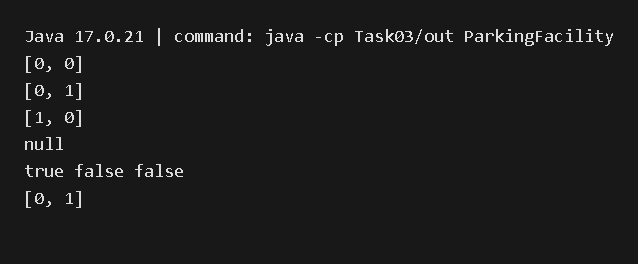

# Task 3 — Control logic and pseudocode

The complete-the-code program preserves the assignment's `main()` and implements both TODOs. Compile and run from the repository root with:

```powershell
javac -d Task03/out Task03/ParkingFacility.java
java -cp Task03/out ParkingFacility
```

Raw output and a visual evidence image rendered from that exact stdout are in `outputs/`.


