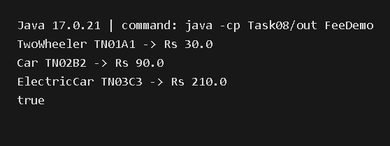

# Task 8 — Polymorphism code exercise

Compile and run from the repository root:

```powershell
javac -d Task08/out Task08/FeeDemo.java
java -cp Task08/out FeeDemo
```

The supplied `main()` is preserved. Equality in the exercise compares registration only; the report explains why a production system should enforce registration uniqueness and choose a consistent identity policy. Raw stdout and a PNG rendered from that stdout are in `outputs/`.


