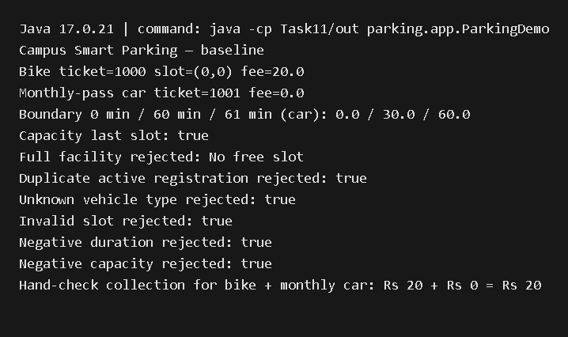

# Task 11 — Baseline model, tests and defence

Compile the sources under `src/` and run `parking.app.ParkingDemo`. Commands are in the root README. See [REPORT.md](../REPORT.md), Task 11. Raw stdout and a PNG rendered from that stdout are in `outputs/`.

