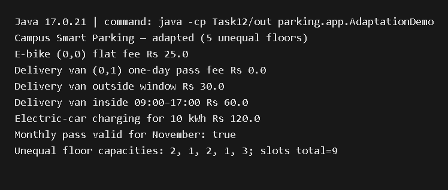

# Task 12 — Design challenge adaptation

The revised system adds e-bikes, delivery vans, a one-day pass and five differently sized floors. Compile and run `parking.app.AdaptationDemo`. See the root README and [REPORT.md](../REPORT.md), Task 12. Raw stdout and a PNG rendered from that stdout are in `outputs/`.

